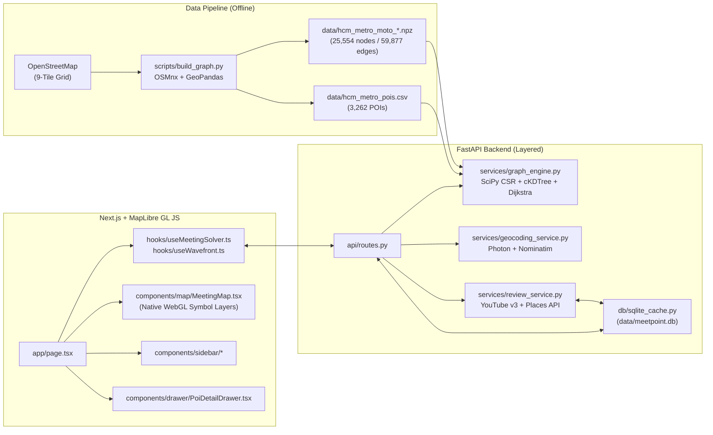

# MeetPoint HCMC

Hệ thống định tuyến và đề xuất điểm hẹn nhóm tối ưu theo thời gian di chuyển thực tế và độ công bằng Pareto trên mạng lưới giao thông nội thành TP.HCM.

---

## 1. Tính năng cốt lõi

* **Định tuyến đa nguồn trên đồ thị đô thị thực tế:** Tính toán đường đi ngắn nhất cho nhóm từ $2$ đến $8$ thành viên trên đồ thị có hướng gồm **25.554 nút giao** và **59.877 cạnh đường** bao phủ vùng lõi nội thành TP.HCM (`10.7250°N – 10.8450°N`, `106.6200°E – 106.7600°E`).
* **Cân bằng Hiệu quả – Công bằng (Pareto Optimization):** Điều chỉnh linh hoạt tham số $\alpha \in [0, 1]$ để chuyển đổi giữa mục tiêu tối thiểu hóa tổng thời gian cả nhóm ($\alpha = 0$) và tối thiểu hóa thời gian của người di chuyển xa nhất ($\alpha = 1$).
* **Nhận thức khung giờ cao điểm (Time-Dependent Routing):** Mô phỏng hệ số suy giảm vận tốc theo cấp đường vào khung giờ tan tầm (`17:30`) so với giờ thông thoáng.
* **Mô phỏng sóng lan truyền đồng bộ (Multi-source Wavefront):** Trực quan hóa quá trình loang đồng thời từ vị trí từng thành viên trên bản đồ WebGL và cắt tỉa trung bình **84.6% – 94.4%** không gian tìm kiếm dư thừa.
* **Dữ liệu địa điểm & trải nghiệm nhóm hoàn chỉnh:**
  * **3.262 địa điểm** (cà phê, quán ăn, nhà hàng) được làm giàu tên đường thật thông qua nối không gian (`gpd.sjoin_nearest` trên hệ chiếu `EPSG:32648`).
  * Tự động dịch ngược tọa độ (*Reverse Geocoding*) khi kéo thả ghim thành viên trên bản đồ.
  * Tích hợp tra cứu video review YouTube Data API v3 / Google Places (kèm SQLite cache) và tạo liên kết chia sẻ phòng họp nhóm (`?room=<id>`).

---

## 2. Kiến trúc hệ thống



### Cấu trúc thư mục

```text
meeting-point/
├── backend/
│   ├── main.py                     # Khởi tạo FastAPI, CORS & gắn router
│   ├── api/routes.py               # Định nghĩa toàn bộ REST API endpoints
│   ├── core/config.py              # Quản lý cấu hình & biến môi trường (.env)
│   ├── db/sqlite_cache.py          # Lưu trữ cache review và phòng chia sẻ (?room=)
│   ├── schemas/meeting.py          # Pydantic request/response schemas
│   └── services/
│       ├── graph_engine.py         # Lõi Dijkstra, Pareto, Wavefront & ánh xạ đỉnh
│       ├── geocoding_service.py    # Tìm kiếm địa chỉ & dịch ngược tọa độ kéo ghim
│       └── review_service.py       # Tích hợp YouTube Data API v3 & Google Places
├── frontend/src/
│   ├── app/page.tsx                # Trang điều phối giao diện chính
│   ├── components/
│   │   ├── map/MeetingMap.tsx      # Bản đồ MapLibre, vòng 450m, layer chống đè nhãn
│   │   ├── sidebar/                # MemberList, FilterBar, PoiList
│   │   ├── drawer/                 # PoiDetailDrawer (thời gian nhóm & video review)
│   │   └── topbar/                 # ZoneHeader (khu vực đề xuất, loang, chia sẻ link)
│   ├── hooks/                      # useMeetingSolver, useWavefront
│   ├── lib/                        # api.ts, geo.ts
│   └── types/meeting.ts            # Định nghĩa kiểu dữ liệu TypeScript
├── scripts/
│   ├── build_graph.py              # Pipeline tải lưới 9 ô OSM & gán địa chỉ đường thật
│   └── benchmark_final.py          # Kiểm thử hiệu năng & độ công bằng trên 300 nhóm
├── notebooks/                      # Nhật ký nghiên cứu & thử nghiệm thuật toán (A1–A7)
├── data/                           # Ma trận đồ thị (.npz), dữ liệu quán (.csv) & SQLite (.db)
└── .env.example                    # Mẫu cấu hình khóa API
```

---

## 3. Cơ sở thuật toán

1. **Hàm chi phí đa mục tiêu Pareto:**
   Với tập hợp $k$ thành viên xuất phát từ các đỉnh $\{s_1, s_2, \dots, s_k\}$, thời gian di chuyển đến đỉnh ứng viên $v$ là $t_i(v)$ (phút). Chi phí tổng hợp của đỉnh $v$ được xác định bởi:
   $$F_{\alpha}(v) = (1 - \alpha) \cdot \frac{1}{k}\sum_{i=1}^{k} t_i(v) + \alpha \cdot \max_{1 \le i \le k} t_i(v)$$

2. **Đánh giá độ công bằng bằng Chỉ số Jain (Jain's Fairness Index):**
   $$J(t_1, \dots, t_k) = \frac{\left(\sum_{i=1}^{k} t_i\right)^2}{k \sum_{i=1}^{k} t_i^2} \in \left[\frac{1}{k}, 1\right]$$
   Giá trị $J$ càng tiến gần $1$ thể hiện thời gian di chuyển giữa các thành viên càng đồng đều.

3. **Lan truyền đồng bộ (Multi-source Wavefront):**
   Khởi chạy $k$ hàng đợi ưu tiên đồng thời theo trục thời gian thực tế và dừng ngay khi tìm thấy nút giao hội tụ đầu tiên của cả $k$ mặt sóng, loại bỏ phần lớn không gian đồ thị nằm ngược hướng di chuyển.

---

## 4. Kết quả thực nghiệm (Benchmark)

Thử nghiệm được thực hiện ngẫu nhiên trên **300 nhóm người dùng** phân bố khắp nội thành TP.HCM (chi tiết lưu tại `data/benchmark_results.json`):

### 4.1. Độ trễ xử lý & Tỷ lệ cắt tỉa Wavefront theo quy mô nhóm ($k$)

| Quy mô nhóm ($k$) | Độ trễ trung bình | Độ trễ p50 | Độ trễ p95 | Không gian đồ thị được cắt tỉa |
| :---: | :---: | :---: | :---: | :---: |
| **$k = 2$** | 48.91 ms | 47.59 ms | 54.41 ms | **94.42%** |
| **$k = 3$** | 69.39 ms | 69.23 ms | 72.96 ms | **90.89%** |
| **$k = 4$** | 90.72 ms | 90.70 ms | 93.86 ms | **87.67%** |
| **$k = 6$** | 200.28 ms | 207.27 ms | 218.50 ms | **84.57%** |

### 4.2. Đánh đổi Hiệu quả – Công bằng ($k = 4$)

| Cấu hình $\alpha$ | Thời gian người xa nhất ($F_{\max}$) | Trung bình mỗi người | Chỉ số công bằng Jain ($J$) |
| :---: | :---: | :---: | :---: |
| **$\alpha = 0.0$** (Tối ưu tổng) | 25.43 phút | **14.48 phút** | 0.7483 |
| **$\alpha = 0.5$** (Cân bằng Pareto) | **19.16 phút** | 15.80 phút | **0.9275** |
| **$\alpha = 1.0$** (Tối ưu công bằng) | 19.00 phút | 16.20 phút | 0.9431 |

* **Nhận xét:** Tại điểm cân bằng $\alpha = 0.5$, thời gian di chuyển của người ở xa nhất giảm **6.27 phút (-24.7%)** và chỉ số công bằng Jain tăng từ **0.7483 lên 0.9275**, trong khi thời gian trung bình mỗi người chỉ tăng **1.32 phút**.

### 4.3. Tác động của giờ cao điểm (`17:30`, $k = 4$)

* **Tỷ lệ dịch chuyển khu vực hẹn tối ưu:** **77.33%** số nhóm thay đổi điểm hẹn tối ưu khi chuyển từ giờ thông thoáng sang giờ cao điểm `17:30`.
* **Thời gian người xa nhất trung bình ($F_{\max}$):** Tăng từ **19.16 phút** (giờ thường) lên **32.18 phút** (`17:30`).

---

## 5. Cài đặt & Khởi chạy

### Yêu cầu môi trường
* Python 3.11+
* Node.js 18+

### Bước 1: Cài đặt Backend & Tạo dữ liệu đồ thị
```bash
# Kích hoạt môi trường ảo
python -m venv .venv
# Windows PowerShell:
.\.venv\Scripts\Activate.ps1

# Cài đặt thư viện
pip install fastapi uvicorn httpx numpy pandas scipy geopandas networkx osmnx

# Tạo file cấu hình môi trường (tùy chọn điền YOUTUBE_API_KEY / GOOGLE_PLACES_API_KEY)
cp .env.example .env

# Xây dựng đồ thị nội thành TP.HCM & trích xuất dữ liệu POI (bỏ qua nếu đã có thư mục data/)
python scripts/build_graph.py

# Chạy benchmark xuất số liệu thực nghiệm
python -m scripts.benchmark_final

# Khởi động API server
uvicorn backend.main:app --reload --port 8000
```

### Bước 2: Khởi động Frontend
```bash
cd frontend
npm install
npm run dev
```
Truy cập ứng dụng tại **`http://localhost:3000`**.

---

## 6. Danh sách API Endpoints

| Phương thức | Endpoint | Mô tả |
| :---: | :--- | :--- |
| `GET` | `/api/health` | Kiểm tra trạng thái engine, số đỉnh đồ thị và số lượng POI |
| `POST` | `/api/solve` | Tính điểm hẹn tối ưu, tuyến đường nhóm và danh sách Top 25 địa điểm |
| `POST` | `/api/poi-routes` | Tính tuyến đường chi tiết từ từng thành viên tới một địa điểm cụ thể |
| `POST` | `/api/wavefront` | Xuất dữ liệu GeoJSON lan truyền đồng bộ theo mốc thời gian $t$ |
| `GET` | `/api/geocode?q=...` | Tìm kiếm tự động địa chỉ & địa điểm tại TP.HCM |
| `GET` | `/api/reverse-geocode` | Dịch ngược tọa độ `(lat, lng)` thành tên đường thật khi kéo ghim |
| `GET` | `/api/pois/{poi_id}/reviews` | Lấy video review YouTube & thông tin đánh giá (có SQLite cache) |
| `POST` | `/api/rooms` | Lưu cấu hình nhóm hiện tại và trả về mã phòng chia sẻ |
| `GET` | `/api/rooms/{room_id}` | Khôi phục trạng thái nhóm từ liên kết chia sẻ |
